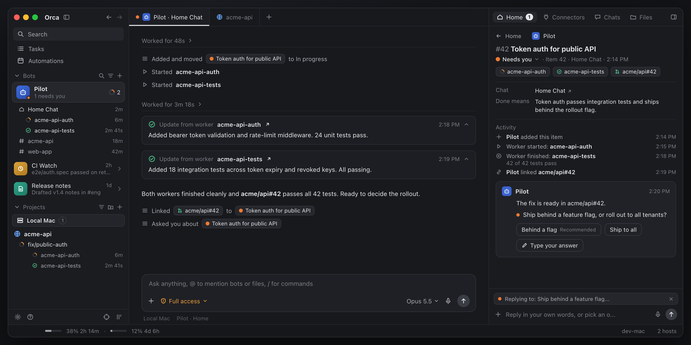

<div align="center">

# Orca Orchestration Skills

[](LICENSE)
[](https://agentskills.io/specification)
[](https://github.com/stablyai/orca)
[](#basic-skills)
[](#advanced-skills)



</div>

Eleven skills for running delegated software work with [Orca](https://github.com/stablyai/orca). A
coordinator (an agent or an Orca bot) writes briefs, coding workers implement them in isolated
worktrees, and every delivery is reviewed against its brief before it is merged or shipped. The
Basic tier covers one coordinator on one repository. The Advanced tier adds a three-level
hierarchy for owners who run several projects at once, with a single channel back to the owner.

## Contents

- [Quick start](#quick-start)
- [Easy prompt for agents](#easy-prompt-for-agents)
- [Basic or Advanced](#basic-or-advanced)
- [Basic skills](#basic-skills)
- [Advanced skills](#advanced-skills)
- [How the skills fit together](#how-the-skills-fit-together)
- [Installation](#installation)
- [Examples](#examples)
- [Compatibility](#compatibility)
- [Verifying the repository](#verifying-the-repository)
- [Contributing](#contributing)
- [License](#license)

## Quick start

1. Clone the repository and link the Basic tier into the skills folder your agent reads:

   ```bash
   git clone https://github.com/tBeltty/orca-orchestration-skills.git
   cd orca-orchestration-skills
   SKILLS_DIR=/path/to/project/.claude/skills
   mkdir -p "$SKILLS_DIR"
   for s in worker-brief-builder delivery-review worker-ops-hygiene bot-items model-routing; do
     ln -s "$PWD/skills/$s" "$SKILLS_DIR/$s"
   done
   ```

2. Check your Orca version with `orca --version`. If it differs from the one in
   [Compatibility](#compatibility), run `orca <command> --help` before relying on a flag.
3. Ask the coordinator to plan a task with `worker-brief-builder`, pick each worker's agent and
   model with `model-routing`, start the workers it describes, and review each `worker_done` with
   `delivery-review`.
4. Read [`examples/basic-session-example.md`](examples/basic-session-example.md) for one complete
   session: an item, two workers, an owner decision, the review and the cleanup.

## Easy prompt for agents

Paste this prompt into your Orca bot or coding agent to have it choose and install the skills for
the current project:

```text
Install the Orca orchestration skills this project needs.

1. Read https://github.com/tBeltty/orca-orchestration-skills, starting with README.md and the
   skills/ directory.
2. Inspect this workspace: how many repositories, bots and machines the work spans, how it
   deploys, whether it handles credentials and what it waits on. Name the agent runtime you are
   (Claude Code, or a sandboxed agent such as Antigravity, opencode or Codex) and the skills
   folder it reads.
3. Recommend the Basic tier by default: bot-items, worker-brief-builder, delivery-review,
   worker-ops-hygiene and model-routing. Add an Advanced skill only when this project meets its
   criterion in the README: multi-level-orchestration for several repositories, bots or machines
   at once; rehearse-risky-operations or change-plan for risky deploys and operations;
   real-environment-proof for code that must pass outside this machine; secrets-and-workers for
   credentials; event-driven-waits for waits on CI, reviews or schedules. Give one reason for
   each skill you add.
4. Show me the proposed skill list and the target directory (.claude/skills/, .agents/skills/
   or .gemini/skills/). Use symlinks when the runtime follows them and real copies when it runs
   sandboxed. List every existing file that would be overwritten, then wait for my approval
   before writing anything.
5. Install only the skills I approve. Check that every installed SKILL.md resolves (no broken
   symlink) and opens with front matter holding name and description. Report the installed
   skills, the install method and the commit of the clone you installed from.
```

The tier check keeps a single-repository project out of the Advanced hierarchy, and the runtime
check avoids symlinks that a sandboxed agent cannot follow out of its workspace.

## Basic or Advanced

Start with **Basic**. Move to **Advanced** only when one of the graduation criteria below holds.

| | Basic | Advanced |
|---|---|---|
| Scope | One repository or one bounded task | Several repositories, bots or machines at once |
| Structure | One coordinator or bot and its workers | Home Governor bot, one Project Coordinator chat per repository, a repo orchestrator per project |
| Owner channel | The coordinator's chat and one item list | Items raised only by the Home Governor, with decisions batched |
| Machine resources | Nothing to arbitrate | One heavy-task slot per machine, granted on measured swap |
| Long runs | One chat holds the plan and the reports | Context use reported upward; rotation through a continuity file |
| Skills to install | The 5 Basic skills | The 5 Basic skills, `multi-level-orchestration`, `event-driven-waits`, and the specialists the work needs |

### Graduation criteria

Move to Advanced when any of these is true:

- two or more repositories have active workers at the same time;
- several bots or long-lived chats need the owner's decisions;
- workers run on more than one machine (`worker-start --on <server>`);
- heavy jobs (engine builds, VMs, full suites, container stacks) from different projects compete
  for one machine's memory;
- a coordinator's context fills before the work ends.

Go back to Basic when only one project remains active. The full criteria are in
[`multi-level-orchestration`](skills/multi-level-orchestration/SKILL.md#stay-in-basic-or-graduate).

The four specialist skills (`real-environment-proof`, `rehearse-risky-operations`, `change-plan`,
`secrets-and-workers`) are listed under Advanced, and each one also joins a Basic setup as soon as
the work touches credentials, ships to another platform or runs an operation that is hard to undo.

## Basic skills

| Skill | Use it when | What it enforces |
|---|---|---|
| [`worker-brief-builder`](skills/worker-brief-builder/SKILL.md) | Before dispatching any worker, and for every follow-up round | A reviewed contract, one owner per file, a model chosen per task, real-environment proof in the brief, "done" defined as a command, batched follow-ups |
| [`delivery-review`](skills/delivery-review/SKILL.md) | A worker reports a task as done | The report checked against the commits, scope checked against the brief, the proof rerun, findings sorted by severity, branches integrated one at a time |
| [`worker-ops-hygiene`](skills/worker-ops-hygiene/SKILL.md) | Coordinating workers | `<Name> \| <task-id>` naming, waking by Orca instead of polling, stops confirmed by receipts and processes, release and worktree cleanup |
| [`model-routing`](skills/model-routing/SKILL.md) | Choosing the agent, model and effort for each worker | Discovery with `orca account list`, `orca agent installed` and `--help` before any model id, a routing policy the owner approves and records in the rules file, one probe worker per new route |
| [`bot-items`](skills/bot-items/SKILL.md) | A bot runs work for its owner | One item per deliverable, Needs you with options and a recommendation, Waiting only with a named wakeup, workers linked to items |

## Advanced skills

| Skill | Use it when | What it enforces |
|---|---|---|
| [`multi-level-orchestration`](skills/multi-level-orchestration/SKILL.md) | Several repositories, bots or machines at once | Home Governor, Project Coordinator chats and repo orchestrators; a heavy-task mutex; context rotation; continuity state kept out of public repositories |
| [`event-driven-waits`](skills/event-driven-waits/SKILL.md) | A bot waits on CI, reviews, workflow runs, messages or a schedule | `watch-pr` and `--once` waits with deadlines, exact workflow runs, prechecks, no polling |
| [`real-environment-proof`](skills/real-environment-proof/SKILL.md) | A change could pass on one machine and fail elsewhere | Tests run inside the CI image, real dependencies exercised with dummy data, the shipped artifact installed and run, strict fakes |
| [`rehearse-risky-operations`](skills/rehearse-risky-operations/SKILL.md) | Before a migration, backfill, bulk message, import, restore or release | A rehearsal mode on the real code path with no side effects, self-explaining failures, a list of what only the real run proves |
| [`change-plan`](skills/change-plan/SKILL.md) | Before a change users notice or one that is hard to undo | Marked steps with rollbacks, changes split so old and new versions overlap, written assumptions, verification |
| [`secrets-and-workers`](skills/secrets-and-workers/SKILL.md) | Delegated work touches credentials | Key names in briefs and logs, test-mode credentials, silent input for the owner's secrets, least privilege, scans before publishing |

## How the skills fit together

Basic:

```
contract ──► worker-brief-builder ──► worker ──► delivery-review ──► merge
                     │                    ▲             │
                     │            model-routing         │
                     │       (agent, model, effort)     │
                     │                                  │
                bot-items (item, Needs you, done)   worker-ops-hygiene (naming, stops, cleanup)
```

Advanced, on top of Basic:

```
Owner
  ▲  items and Needs you
Home Governor Bot ── heavy-task slot, priorities, coordinator health
  ▲  status / question            ▼  --chat new
Project Coordinator chat (one per repository)
  ▲  worker_done / ask            ▼  worker-start
Repo Orchestrator ──► ephemeral workers in child worktrees

event-driven-waits wakes any level on CI, reviews and schedules.
real-environment-proof, rehearse-risky-operations, change-plan and secrets-and-workers
join the briefs and reviews of the work that needs them.
```

## Installation

Each skill is a directory with a `SKILL.md` file: YAML front matter with `name` and `description`,
then the instructions, following the [Agent Skills](https://agentskills.io/specification) format.
Put the directories in the skills folder your agent reads, for example a project's
`.claude/skills/` or a shared `.agents/skills/`. Install only the tier you use.

**Basic tier** (five skills):

```bash
BASIC=(worker-brief-builder delivery-review worker-ops-hygiene bot-items model-routing)
```

**Advanced tier** (the Basic five plus six):

```bash
ADVANCED=("${BASIC[@]}" multi-level-orchestration event-driven-waits real-environment-proof
  rehearse-risky-operations change-plan secrets-and-workers)
```

**Symlink** when the agent follows links. A `git pull` in the clone updates every project that
links to it:

```bash
for s in "${BASIC[@]}"; do ln -s "$PWD/skills/$s" "$SKILLS_DIR/$s"; done
```

**Copy** when the agent runs sandboxed and reads only real files inside its workspace. Record the
commit you copied from, so you can tell later whether the copy is current:

```bash
for s in "${BASIC[@]}"; do cp -R "skills/$s" "$SKILLS_DIR/"; done
git rev-parse --short HEAD
```

Run both from the root of your clone, with `SKILLS_DIR` set as in [Quick start](#quick-start).
Replace `BASIC` with `ADVANCED` in the loop to install the Advanced tier. The snippets work in
bash and zsh.

## Examples

The [`examples/`](examples/) directory has filled-in versions for fictional projects:

- [`basic-session-example.md`](examples/basic-session-example.md): one bot, two workers, an item
  with a Needs you decision, review and cleanup.
- [`advanced-session-example.md`](examples/advanced-session-example.md): three repositories, the
  heavy-task mutex, one batched owner decision, a context rotation and a pull request wait.
- [`brief-example.md`](examples/brief-example.md): a first brief and a follow-up round.
- [`contract-example.md`](examples/contract-example.md): a reviewed contract for a CSV import.
- [`delivery-review-example.md`](examples/delivery-review-example.md): the review of that import's
  delivery, with a blocker found by rerunning the proof.
- [`rehearsal-log-example.md`](examples/rehearsal-log-example.md): a failing and a passing
  rehearsal of a plan migration that emails users, and the list of live checks.
- [`change-plan-example.md`](examples/change-plan-example.md): a column replaced in three releases,
  with rollbacks and written assumptions.

## Compatibility

Every `orca` command and flag in these skills and examples was checked against Orca 1.4.280
(`orca <command> --help` and `orca agent-context --json`). This line and the badge at the top
are the only places that record a version. Bot commands such as `orca bot item` are missing from
`orca agent-context`, so the check reads their `--help`. Flags move between Orca versions; run
`--help` on yours before relying on one.

## Verifying the repository

`scripts/verify.py` needs only Python 3. It prints every problem it finds and exits 1 when there
is at least one:

```bash
python3 scripts/verify.py              # front matter, links, README counts, prose, privacy
python3 scripts/verify.py --check-cli  # also checks every orca command and flag on this host
```

`--check-cli` reads every `orca ...` command in the Markdown files and compares each subcommand
and `--flag` with `orca agent-context --json` and `orca <command> --help`, and the version above
with `orca --version`.

## Contributing

Issues and pull requests are welcome. A good addition names the failure it prevents, the check that
catches it and an example with placeholder data. Before opening a pull request, run
`python3 scripts/verify.py --check-cli` and fix what it reports.

## License

MIT. See [LICENSE](LICENSE).
